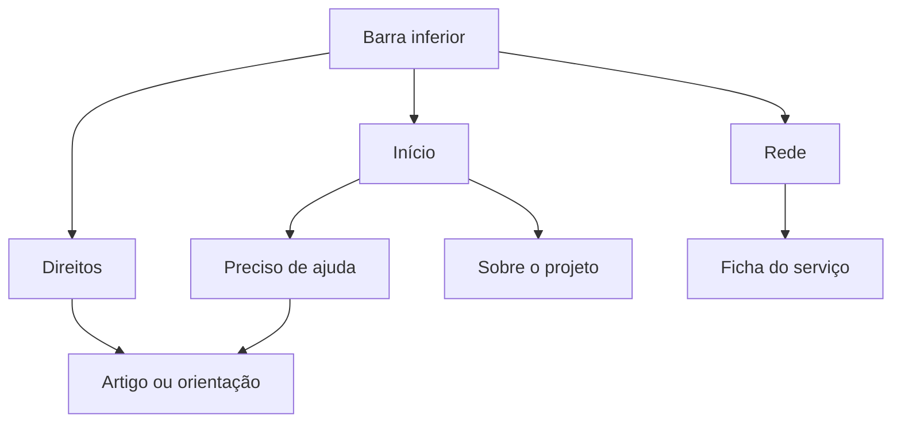

# Plano de layout do app Conselho Tutelar de Boituva

**Android · Jetpack Compose e Material 3 · Projeto de extensão da UNIASSELVI**

A primeira ação no Início é **Preciso de ajuda**. A segunda tela organiza os canais pela situação que trouxe a pessoa ao app. O guia e o diretório aparecem na mesma navegação, para quem quer entender seus direitos ou encontrar atendimento em Boituva.

O plano parte da jornada Início e Preciso de ajuda e descreve as telas e os critérios de aceite. Consulte [Requisitos e evidências](requisitos.md) para acompanhar a implantação e a liberação de conteúdo.

## Navegação

Use três destinos na barra inferior, **Início**, **Direitos** e **Rede**, quando esses três destinos estiverem disponíveis. A jornada **Preciso de ajuda** é aberta pelo botão principal do Início, pelo guia de orientação e por links contextuais. Sobre abre por um item de texto no Início. Ajuda e telas de detalhe ocupam a tela inteira, com botão Voltar na barra superior. O Voltar do Android retorna à origem e preserva a posição de leitura na lista.

Para validar a navegação antes de introduzir a barra inferior, Início pode usar atalhos para os destinos conforme forem entregues.

## Layout por tela

A ordem em cada linha corresponde ao que aparece de cima para baixo no celular. Artigo, orientação e ficha usam componentes de detalhe compartilhados, com conteúdo e ações próprios.

| Tela | Hierarquia de conteúdo | Ações e navegação | Requisito |
| --- | --- | --- | --- |
| **Início** | Cabeçalho “Conselho Tutelar de Boituva”, identificação “Projeto de extensão da UNIASSELVI”, botão largo **Preciso de ajuda**, atalho compacto de urgência policial com Polícia Militar e 190, linhas para “Conheça seus direitos”, “Rede de proteção” e “Sobre o projeto”. Campanhas entram abaixo dos atalhos quando houver material aprovado. | Abrir Ajuda. O atalho do 190 abre o discador, reaproveitando a mesma ação e o mesmo registro do catálogo. Se a barra inferior já estiver presente, os acessos a Direitos e Rede no corpo só entram quando trouxerem um destino ou uma descrição útil. | RF01, RF02, RNF06 |
| **Preciso de ajuda** | Barra superior com Voltar e título, **Urgência policial** com Polícia Militar, **Emergência médica** com SAMU, **Comunicar uma suspeita ou violação** com Conselho Tutelar e Disque 100. As três categorias ficam na ordem do fluxo atual, com as urgências em cartões compactos. O link “Como comunicar uma suspeita” fica junto ao terceiro grupo. | Cada cartão mostra órgão e número em texto, com “Abrir discador” como ação principal. “Copiar número”, “Abrir WhatsApp” e “Abrir site” aparecem conforme o catálogo. “Fonte e conferência” expande a referência e a data. Um aviso curto explica as dependências das ações externas, sem ocupar o topo antes das urgências. | RF01, RF02, RF03, RNF05 |
| **Orientação sobre suspeita** | Título “Como comunicar uma suspeita”, resumo curto, seções “Quando buscar ajuda”, “O que informar ao canal oficial”, “Como acolher” e “Depois do contato”. Inclui um bloco “Preciso de ajuda para mim” e uma seção própria do Disque 100 para anonimato e acompanhamento pelo protocolo do serviço, após revisão editorial. | “Ver canais de ajuda” volta ou leva ao grupo de suspeita. Referências oficiais no fim. A leitura funciona offline e o relato é comunicado pelo canal escolhido. | RF03, RNF01, RNF03 |
| **Conheça seus direitos** | Título, linha “O que faz o Conselho Tutelar”, lista de temas do ECA, link “Como comunicar uma suspeita” e bloco de dúvidas frequentes. Temas sugeridos pelo levantamento incluem saúde, educação, convivência familiar e comunitária, dignidade e respeito, esporte, lazer e cultura. | Tocar em um tema abre o artigo. Cada pergunta frequente expande a resposta na mesma tela. As respostas maiores podem levar ao artigo correspondente. | RF04, RNF02, RNF03 |
| **Artigo do guia** | Voltar, título, resumo em linguagem simples, subtítulos com parágrafos curtos, referências e data de conferência. O conteúdo sobre o Conselho explica suas atribuições e para quais serviços os casos podem ser encaminhados. | Link “Preciso de ajuda” quando for pertinente ao tema. Links de referência identificam o destino externo. | RF04, RNF03, RNF04 |
| **Rede de proteção** | Título “Rede de proteção”, lista por necessidade ou tipo de serviço. Cada item apresenta nome e uma linha sobre o que a pessoa encontra ali. As categorias previstas são Conselho Tutelar, assistência social, saúde e segurança. Em assistência, os itens podem incluir CRAS, CREAS e onde buscar apoio com alimentação, higiene e vestuário, conforme dados validados. | Tocar na linha abre a ficha. Se uma categoria ainda não tiver unidades locais validadas, a orientação geral pode indicar o caminho de ajuda disponível. | RF05, RNF03 |
| **Ficha do serviço** | Nome do serviço, “Para que serve”, formas de contato, endereço, horário, área atendida e condições de acesso quando confirmados, além de fonte e data. Os campos são exibidos individualmente conforme a conferência. | “Abrir discador”, “Copiar número”, “Abrir WhatsApp” e “Abrir no mapa” conforme os dados disponíveis. O endereço confirmado aparece em texto para consulta offline. | RF02, RF05, RNF04, RNF05 |
| **Sobre o projeto** | Objetivo do app, identificação “Projeto de extensão de ADS da UNIASSELVI”, explicação do caráter informativo e fontes do projeto. Materiais de identidade institucional entram após aprovação. | Link “Ver canais oficiais de ajuda”. Se o canal editorial for aprovado, “Sugerir uma correção” abre esse canal e descreve seu uso para ajustes de informação. | RNF06, RF07, RF08 desejável |

**Campanhas e materiais educativos (RF06, desejável).** Card no Início com título, resumo, fonte, data e vigência quando aplicável. “Ver material” abre o destino institucional e “Compartilhar link” usa a folha de compartilhamento do Android. Um detalhe dentro do app deve existir apenas quando houver conteúdo próprio suficiente para leitura. Campanhas encerradas saem do destaque.

**Colaboração editorial (RF07).** A revisão acontece no processo do projeto, com fonte, data, responsável e aprovação registrados em `docs/validacao-campo.md`. A parte visível no app é a referência e a data de conferência de cada conteúdo.

## Componentes e estados

| Elemento ou situação | Especificação |
| --- | --- |
| Identidade visual | Material 3 com fundo claro, verde-petróleo e ícones lineares acompanhados por rótulos. O 190 tem destaque vermelho, Direitos usa azul e orientações de acolhimento usam âmbar. Painéis de título, cartões e ações seguem a mesma hierarquia tipográfica. |
| Espaçamento e fonte ampliada | Base de 16 dp nas margens e cartões, 8 dp entre itens relacionados e 24 dp entre blocos. Áreas de toque de pelo menos 48 dp. Usar coluna rolável, alturas flexíveis e ações empilhadas quando uma linha não comportar a fonte. Respeitar os insets das barras do Android. |
| Cartão de contato | Nome e telefone primeiro, discador em destaque, ações secundárias de copiar ou abrir outro serviço e bloco expansível de fonte e data. Rótulos de acessibilidade incluem o nome do órgão, inclusive quando o botão visível é curto. |
| Copiar ou falhar ao abrir | Exibir “Número copiado” após a ação. Em falha, informar qual serviço não abriu e indicar “Copiar número” ou outro canal disponível no próprio cartão. O app abre o discador preenchido e a confirmação ocorre no sistema. |
| Offline | Abertura a frio carrega números e conteúdo básico do APK. A interface informa junto às ações que links dependem de internet e chamadas dependem de rede telefônica. Texto, número, fonte registrada e data continuam legíveis. |
| Dados pendentes | Usar somente dados liberados para exibição. Horários, endereço, rota, plantão e cobertura do WhatsApp fora do expediente dependem da conferência registrada. Se um campo estiver pendente, a ficha pode exibir os outros dados já liberados. |
| Privacidade | Todas as telas são públicas. Endereços exibidos pertencem aos serviços publicados. Relatos e protocolos são tratados pelos canais oficiais. O app abre o discador e o mapa por ações externas, sem exigir permissões de telefone ou localização. |

## Ordem para implementar

| Entrega | Trabalho e critério de aceite |
| --- | --- |
| **1. Início e ajuda** · RF01 e RF02 | Evoluir as duas telas existentes. Confirmar que o botão principal abre Ajuda, que as três categorias aparecem na ordem prevista e que o atalho policial e o cartão usam o mesmo registro. Preservar o teste de discador, cópia e fallback com números fictícios. Se os textos visíveis mudarem, atualizar os seletores do `HelpFlowTest` junto com o layout. |
| **2. Orientações e Direitos** · RF03 e RF04 | Entregar Orientação, lista de temas, artigo e FAQ. Verificar navegação nos dois sentidos entre Ajuda e Orientação, leitura offline e publicação das referências e datas. Revisar anonimato e protocolo com fontes oficiais antes de fechar o texto. |
| **3. Rede e Sobre** · RF05 e RNF06 | Entregar diretório e ficha, testar abertura de rota com destino fictício e conferir que campos sem publicação liberada ficam ocultos. Fechar os três destinos da barra inferior e a identificação acadêmica em Sobre. Registrar as pendências municipais em `validacao-campo.md`. |
| **4. Campanhas e correções** · RF06 e RF08 | Incluir quando houver material e canal aprovados. Conferir vigência, ação de compartilhamento e destino editorial. |

Em cada entrega, validar o fluxo de Voltar, a ordem de foco com TalkBack, a legibilidade com fonte ampliada e a consulta em modo avião. Registrar os testes por requisito na matriz do harness. Na validação presencial, usar cenários fictícios para verificar se uma pessoa consegue achar urgência policial, uma orientação de suspeita e uma ficha de serviço sem ajuda.

## Base consultada

- [Commit do harness e fluxo atual](https://github.com/GustavoAlves07/atividade-de-extensao-conselho-tutelar/commit/736d7c8acc744a7ced231fb24458114801f9ef65)
- [Matriz de requisitos](https://github.com/GustavoAlves07/atividade-de-extensao-conselho-tutelar/blob/736d7c8acc744a7ced231fb24458114801f9ef65/docs/requisitos.md)
- [Validação de campo](https://github.com/GustavoAlves07/atividade-de-extensao-conselho-tutelar/blob/736d7c8acc744a7ced231fb24458114801f9ef65/docs/validacao-campo.md)
- Pesquisa e levantamento de informações para o app do Conselho Tutelar de Boituva, etapa 1 do projeto de extensão (23 de novembro de 2026).
